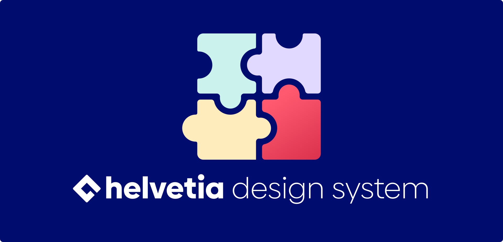

> [!IMPORTANT] > **The Baloise Design System is no longer being developed further.**
> Development has moved to the new **[Helvetia Design System](https://helvetia-design.vercel.app/)**.
> Migration skills will be provided to help with the transition. 🚀
>
> The current Baloise Design System remains available at **[baloise-design-system.vercel.app](https://baloise-design-system.vercel.app)**.

 
 

  The Baloise Design System consists of reusable components and a clearly defined visual style, that can be assembled together to build any number of applications.

